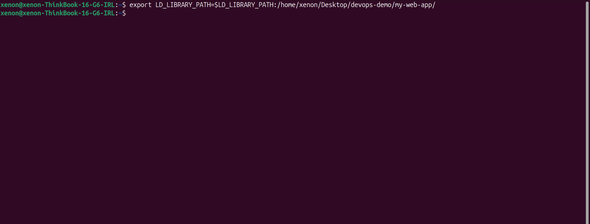
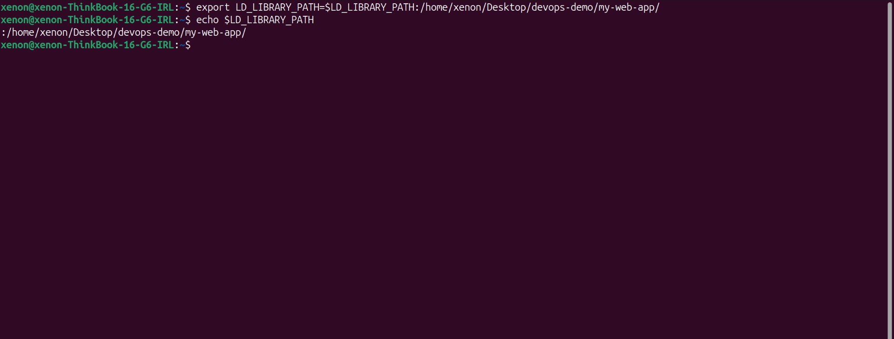
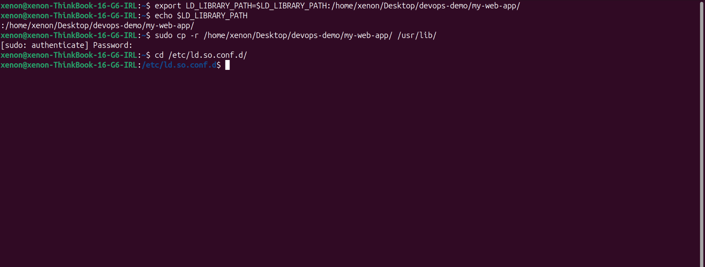
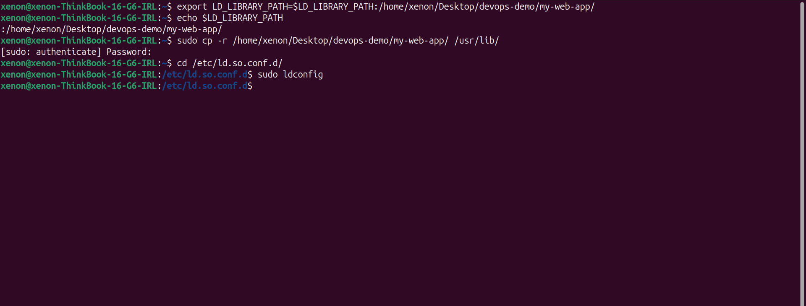

# how to add libary?

### 1- first testing
#### run this command:
```bash
export LD_LIBRARY_PATH=$LD_LIBRARY_PATH:/home/server1/library/
```

---

### 2- check path is entirely added
#### run this command:
```bash
echo $LD_LIBRARY_PATH
```


> ***:/home/xenon/Desktop/devops-demo/my-web-app/*** 
this output means adding path was sucsessfull
---
### 3- copying path

#### copy engitre path into ***/usr/lib/***, And then create a library configuration file within the /etc/ld.so.conf.d/ directory that points to the library file’s location.



```bash
 sudo cp -r /home/xenon/Desktop/devops-demo/my-web-app/ /usr/lib/
```
```bash
cd /etc/ld.so.conf.d/
```
---
### 4- finnaly updating cache

```bash
sudo ldconfig
```

---

> ### If I am troubleshooting the library cache, I must use "***ldconfig -v***" command:
```bash
ldconfig -v 2> /dev/null |grep git
```

