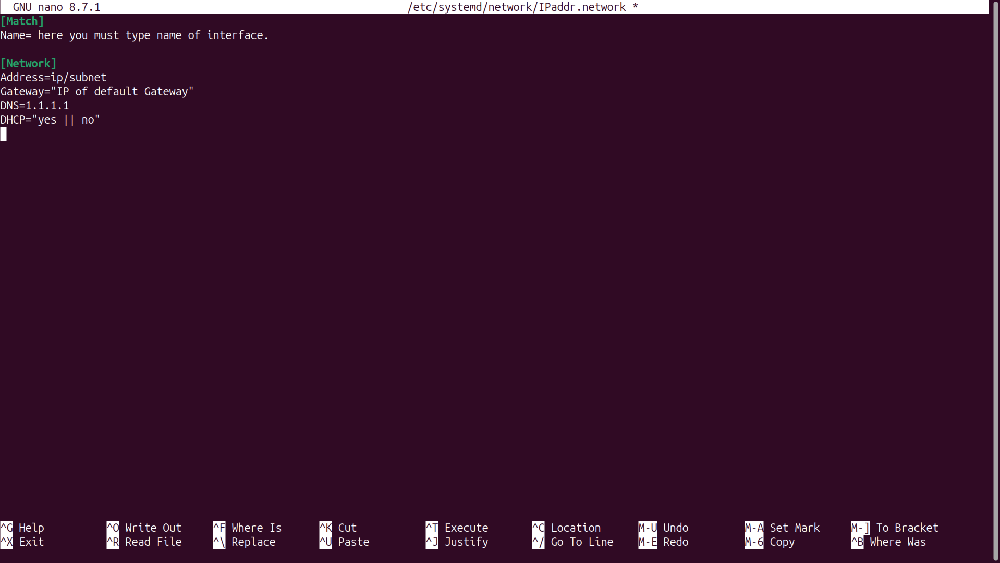

# how to setup DHCP && Static IP with systemd?

### 1- create directory in following path:
```bash
sudo nano /etc/systemd/network/IPaddr.network
```



### 2- now started it with systemctl:
```bash
sudo systemctl restart now systemd-networkd
````
